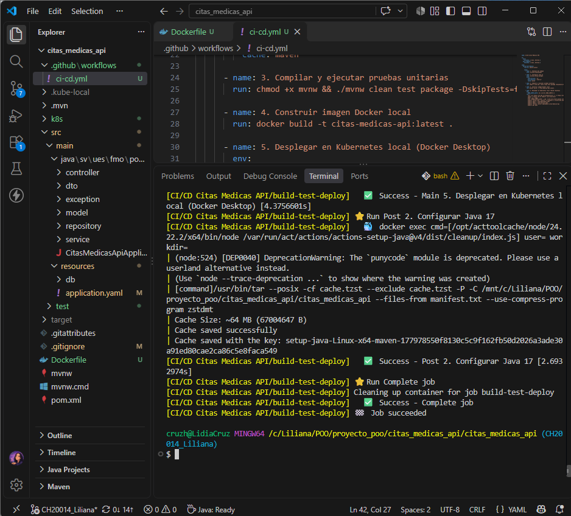
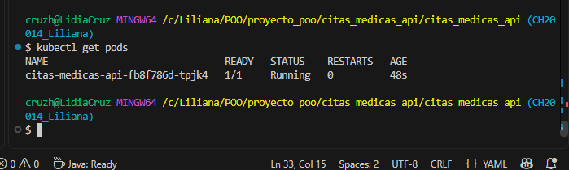
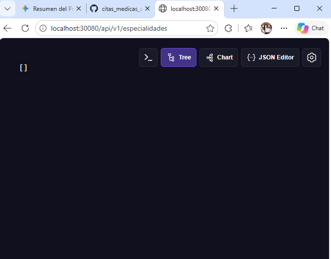

# Despliegue Continuo (CI/CD), Docker y Kubernetes

Este documento describe el flujo automatizado de integración, contenerización y despliegue implementado para **Virtual Medical API**.

## 1. Contenerización (`Dockerfile`)
- Construcción *multi-stage* con Maven y Eclipse Temurin JRE 17 para generar una imagen ligera (`citas-medicas-api:1.0`).

## 2. Pipeline CI/CD (`.github/workflows/ci-cd.yml`)
Validado localmente mediante `act`:
- **Integración Continua (CI):** Compilación del proyecto y ejecución automatizada de pruebas con Maven (`mvn test`).
- **Entrega Continua (CD):** Construcción de la imagen Docker (`citas-medicas-api:1.0`) y despliegue automático en Kubernetes con `kubectl`.

## 3. Orquestación en Kubernetes (`k8s/`)
- `k8s/deployment.yaml`: Despliega el pod de la API configurando la conexión a PostgreSQL (`host.docker.internal`), la variable `DB_PASSWORD` y el esquema de base de datos.
- `k8s/service.yaml`: Expone la API mediante un servicio `NodePort` en el puerto `30080` (mapeado al puerto interno `8080`).

## Comandos Rápidos para Despliegue Local
```bash
# 1. Construir la imagen Docker localmente
docker build -t citas-medicas-api:1.0 .

# 2. Aplicar manifiestos de Kubernetes
kubectl apply -f k8s/

# 3. Exponer el servicio localmente en el puerto 30080
kubectl port-forward service/citas-medicas-service 30080:8080

```

## Evidencias de Ejecución

### 1. Pipeline CI/CD ejecutado localmente con `act`


### 2. Despliegue activo en Kubernetes (`1/1 Running`)


### 3. API respondiendo en el puerto `30080`
